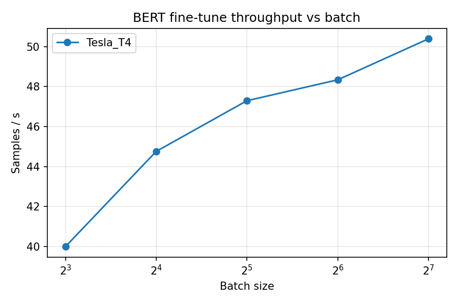

# HW4.a / HW4.5 results (generated by report.py)
## HW4.a — Tesla_T4

Rows used: **0–4999** (5000 rows of 45615); split {'train': 3500, 'val': 750, 'test': 750}; labels {'0': 769, '1': 2294, '2': 1937}
| Epoch | Train loss | Val loss | Val acc | Epoch time (s) |
|---|---|---|---|---|
| 1 | 0.9638 | 0.8773 | 0.5667 | 71.4 |
| 2 | 0.6694 | 0.7726 | 0.6387 | 72.2 |
| 3 | 0.4625 | 0.7739 | 0.6693 | 72.5 |
| 4 | 0.3338 | 0.8115 | 0.6787 | 72.8 |

Validation loss stopped improving after epoch **2**; 2 extra epoch(s) cost 145.3 s of training (compare val loss/acc of the last epoch vs the best one above for the accuracy cost).

Confusion matrix (rows = true, cols = predicted):

| true \ pred | 0 | 1 | 2 |
|---|---|---|---|
| 0 | 61 | 36 | 8 |
| 1 | 33 | 225 | 78 |
| 2 | 11 | 73 | 225 |

| Class | Precision | Recall | F1 | Support |
|---|---|---|---|---|
| 0 | 0.581 | 0.581 | 0.581 | 105 |
| 1 | 0.674 | 0.670 | 0.672 | 336 |
| 2 | 0.723 | 0.728 | 0.726 | 309 |

Worst class: **0**. Misclassified examples:

| Text | Gold | Pred | Diagnosis |
|---|---|---|---|
| "I may be Asian, but it doesn't mean I automatically like T-ara. I'm not even familiar with KPOP. #DirectionersFuneral" | 0 | 1 | Annoyance expressed only through negation ('doesn't mean', 'not even'); no overtly negative words. |
| when you hungry af but Dunkin is closed on Sunday's &amp; conn don't open until 10 | 0 | 1 | Frustration in slang and a run-on factual complaint; model reads it as a statement about opening hours. |
| "Well Jokes apart, today or tomorrow Yakub has to meet with with 72 Hoors. S" | 0 | 1 | Dark humour about an execution; negativity requires world knowledge the model lacks. |
| HOF president: Frank Gifford 'built the game': The passing of Frank Gifford cast a cloud over Sunday's proceed... | 0 | 1 | Neutral-toned news headline about a death; label reflects the event, not the tone (arguable label noise). |
| Kanye West to run for US president No guys c'mon. POTUS is the most powerful man in the world. Get serious. Tho he'd be bettern tham Trump | 0 | 2 | Mixed sentiment; the closing comparative 'better than Trump' outweighs the earlier dismissive tone. |

**HW4 baseline (for HW4.5 only):** peak GPU memory 4.01 GB allocated (4.60 GB reserved), training wall-clock 289.0 s (321.3 s incl. validation), test acc 0.6813.

### Table HW4.1 / Part D — Serving comparison (Tesla_T4, model Qwen/Qwen2.5-0.5B-Instruct, 128 new tokens)

| Configuration | Tokens/sec | p50 latency (ms) | p95 latency (ms) |
|---|---|---|---|
| HF pipeline, batch 1 | 30.7 | 4172.3 | 4251.2 |
| vLLM, batch 1 | 171.9 | 744.1 | 749.5 |
| vLLM, batch 8 | 1231.2 | 831.5 | 836.9 |
| vLLM, batch 32 | 3364.9 | 1216.4 | 1224.2 |

No crossover in 1/8/32: vLLM per-request latency stayed below the HF batch-1 baseline.

## Part A — Batch scaling to the memory wall

**Tesla_T4** (15.6 GB): max batch **128**, OOM at 256

| Batch | Samples/s | Peak alloc (GB) | Peak reserved (GB) | Epoch time (s) |
|---|---|---|---|---|
| 8 | 40.0 | 2.25 | 2.43 | 90.8 |
| 16 | 44.8 | 2.66 | 3.03 | 79.7 |
| 32 | 47.3 | 4.01 | 4.25 | 72.7 |
| 64 | 48.3 | 6.56 | 6.70 | 70.9 |
| 128 | 50.4 | 11.76 | 12.11 | 70.0 |
| 256 | OOM |  |  |  |

Throughput plateau (next doubling gains <5%): batch **32** on Tesla_T4.



## Part B — Memory techniques (Tesla_T4)

| Technique | Max batch | Throughput (samp/s) | Peak memory (GB) | Eval accuracy |
|---|---|---|---|---|
| Baseline (HW4 settings) | 128 | 48.8 | 4.01 | 0.6813 |
| Mixed precision (fp16) | 256 | 154.1 | 3.24 | 0.6733 |
| Gradient checkpointing | 512 | 36.2 | 2.24 | 0.6813 |
| Gradient accumulation (8x32=256) | 128 phys → eff 256 | 46.0 | 2.26 | 0.5987 |
| 8-bit optimiser (adamw8bit) | 128 | 48.6 | 3.32 | 0.6760 |
| Best combination (amp=fp16, optim=adamw8bit) | 256 | 161.9 | 2.58 | 0.6800 |

Throughput and peak memory are measured at the HW4 reference batch (32) so they are comparable.

Gradient checkpointing throughput cost: 25.8% (48.8 → 36.2 samp/s).

Gradient accumulation: effective batch 256 from physical 8; 52 optimiser steps in 281.0 s (acc 0.5987) vs physical batch 256: n/a s (acc n/a) OOM -- accumulation is the only way.

**Ranking — memory saved per unit throughput lost** (GB saved ÷ % throughput lost, loss floored at 0.5%):

| Rank | Technique | Memory saved (GB) | Throughput lost (%) | GB per % lost |
|---|---|---|---|---|
| 1 | Mixed precision (fp16) | 0.77 | -215.7 | 1.542 |
| 2 | 8-bit optimiser (adamw8bit) | 0.69 | 0.5 | 1.382 |
| 3 | Gradient accumulation (8x32=256) | 1.75 | 5.7 | 0.309 |
| 4 | Gradient checkpointing | 1.77 | 25.8 | 0.069 |

## Part C — DDP (Tesla T4, Tesla T4)

Pairing: homogeneous, single-node. Gradient size 438 MB (fp32).
| Per-GPU batch | 1-GPU samp/s | 2-GPU samp/s | Scaling eff. | Comm/step (ms) | Comm % | Eff. grad BW (GB/s) | Dominates |
|---|---|---|---|---|---|---|---|
| 8 | 43.3 | 72.4 | 0.84 | 22.8 | 10.3 | 19.24 | computation |
| 16 | 47.2 | 82.3 | 0.87 | 20.0 | 5.1 | 21.90 | computation |
| 32 | 48.3 | 94.9 | 0.98 | 36.6 | 5.4 | 11.96 | computation |
| 64 | 51.1 | 98.8 | 0.97 | 32.3 | 2.5 | 13.57 | computation |
| 128 | 51.0 | 100.2 | 0.98 | 26.0 | 1.0 | 16.83 | computation |

Standalone NCCL all-reduce of the gradient buffer: 56.3 ms, algbw 7.78 GB/s, busbw 7.78 GB/s.

First per-GPU batch with >1.2× speed-up over 1 GPU: **8**.

Topology:
```
	GPU0	GPU1	CPU Affinity	NUMA Affinity	GPU NUMA ID
GPU0	 X 	PHB	0-3	0		N/A
GPU1	PHB	 X 	0-3	0		N/A

Legend:

  X    = Self
  SYS  = Connection traversing PCIe as well as the SMP interconnect between NUMA nodes (e.g., QPI/UPI)
  NODE = Connection traversing PCIe as well as the interconnect between PCIe Host Bridges within a NUMA node
  PHB  = Connection traversing PCIe as well as a PCIe Host Bridge (typically the CPU)
  PXB  = Connection traversing multiple PCIe bridges (without traversing the PCIe Host Bridge)
  PIX  = Connection traversing at most a single PCIe bridge
  NV#  = Connection traversing a bonded set of # NVLinks

```

## Part D — KV cache (Tesla_T4, Qwen/Qwen2.5-0.5B-Instruct, batch 8)

Analytic KV bytes/token: 12288 (12 KiB)

| Context | KV measured (GB) | KV analytic (GB) | Forward peak Δ (GB) |
|---|---|---|---|
| 256 | 0.025 | 0.025 | 0.15 |
| 512 | 0.050 | 0.050 | 0.41 |
| 1024 | 0.101 | 0.101 | 1.35 |
| 2048 | 0.201 | 0.201 | 4.82 |
| 4096 | OOM |  |  |

vLLM KV pool: 1035472 tokens (12.72 GB). Longest context at batch 8: **32768** tokens; verification run: {'context': 32768, 'completed': 8, 'wall_s': 573.4521600030002}

## Part E — GPU-hours for one full fine-tune

Tesla_T4, Baseline (HW4 settings): 45,615 rows × 0.7 train × 4 epochs = 127,722 samples ÷ 48.3 samp/s = 2,645 s = **0.73 GPU-hours** (training only, excl. eval).

Tesla_T4, Best combination (amp=fp16, optim=adamw8bit): 45,615 rows × 0.7 train × 4 epochs = 127,722 samples ÷ 161.4 samp/s = 791 s = **0.22 GPU-hours** (training only, excl. eval).
